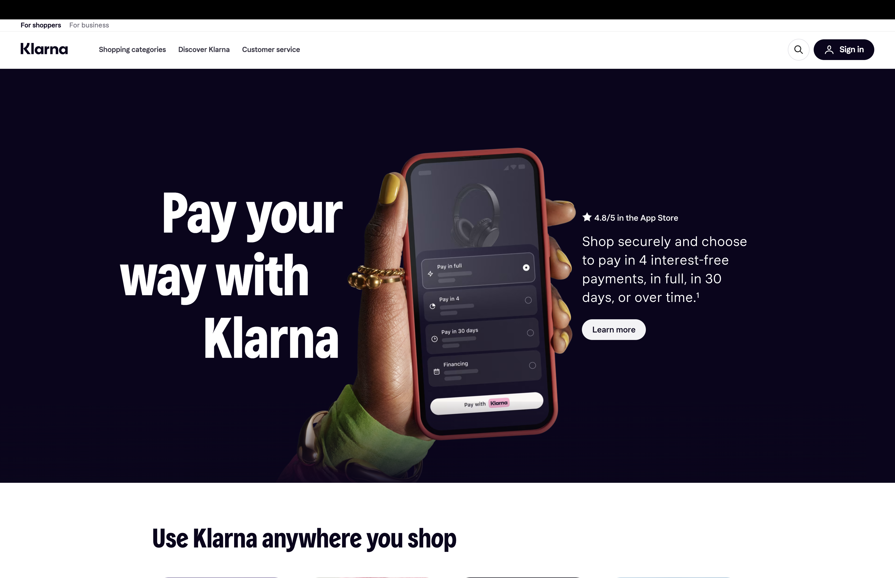
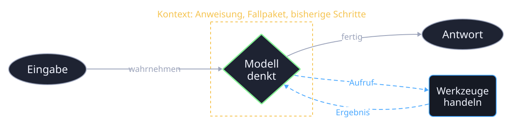
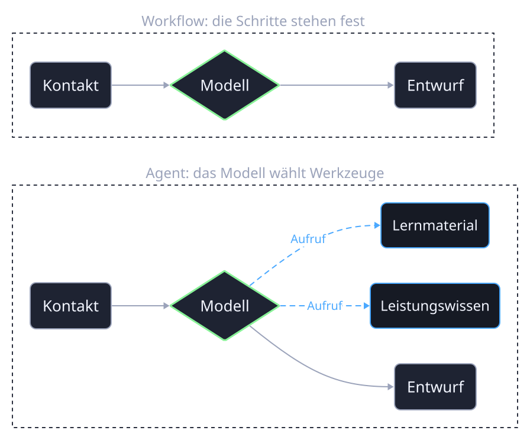

## Ein Agent im Kundenkontakt: Klarna

{fig-alt="Klarna-Kundenservice-Assistent" width="55%"}

::: {.ws-cards}
::: {.ws-card}
[Anfragen]{.ws-card__tag}

[Zwei Drittel]{.ws-h}

der Kundenanfragen bearbeitet der Assistent im ersten Monat selbst.
:::
::: {.ws-card}
[Zeit]{.ws-card__tag}

[Minuten statt Stunden]{.ws-h}

Die Lösungszeit sinkt von etwa elf Minuten auf unter zwei.
:::
::: {.ws-card}
[Grenze]{.ws-card__tag}

[Mensch bleibt]{.ws-h}

Unklare und heikle Fälle gehen an Mitarbeitende, der Assistent übergibt.
:::
:::

::: {.notes}
Einstieg mit einem Fall, den alle kennen. Klarna hat den Assistenten 2024 vorgestellt, die Zahlen stammen aus der Pressemitteilung zum ersten Monat. Wichtig ist die dritte Karte: Der Agent ersetzt nicht die Entscheidung, er übernimmt den Standardfall und übergibt den Rest. Genau diese Grenze ziehen die Teams in ihrer Skizze.
:::

## Ein Agent verfolgt ein Ziel, nimmt wahr, denkt und handelt

::: {.ws-cards}
::: {.ws-card .fragment}
[1]{.ws-card__tag}

[Ziel]{.ws-h}

Ein Auftrag, der mehr als einen Schritt braucht. Beispiel: Für einen Webinar-Kontakt den passenden nächsten Schritt finden.
:::
::: {.ws-card .fragment}
[2]{.ws-card__tag}

[Wahrnehmen]{.ws-h}

Eingaben lesen: Kontaktfelder, Anliegen, Regeln aus dem Fallpaket.
:::
::: {.ws-card .fragment}
[3]{.ws-card__tag}

[Denken]{.ws-h}

Das Modell ordnet ein und plant: Material, Rückfrage oder Gespräch, und was dafür fehlt.
:::
::: {.ws-card .fragment}
[4]{.ws-card__tag}

[Handeln]{.ws-h}

Werkzeuge nutzen: nachschlagen, lesen, schreiben. Ergebnis prüfen und bei Bedarf einen weiteren Schritt gehen.
:::
:::

::: {.notes}
Definition nach Google, Agents-Whitepaper 2024. Die vier Karten sind der Anker für alles Weitere. Der Starter vom Montag deckt Wahrnehmen und Denken ab, das Handeln fehlt dort noch: Das Modell schreibt nur, es ruft nichts auf.
:::

## Die Schleife: Das Modell ruft Werkzeuge auf, bis die Aufgabe gelöst ist

{fig-alt="Schleife: Eingabe, Modell im Kontext denkt, ruft Werkzeuge auf, bekommt Ergebnisse zurück, gibt am Ende die Antwort aus." height="330px" fig-align="center"}

::: {.ws-note}
Der gelbe Rahmen ist der Kontext: alles, was das Modell in diesem Moment sieht. Werkzeuge liefern neue Informationen hinein, deshalb kann der Agent mehr als eine einzelne Anfrage.
:::

::: {.notes}
ReAct-Muster, Yao et al. 2023: Reasoning und Acting im Wechsel. Der entscheidende Unterschied zum Workflow ist die Rückkante von den Werkzeugen ins Modell. Im Workflow gibt es sie nicht, dort ist die Reihenfolge fest.
:::

## Drei Bausteine: Modell, Werkzeuge, Kontext

::: {.ws-cards}
::: {.ws-card .fragment}
[Baustein 1]{.ws-card__tag}

[Modell]{.ws-h}

Versteht Sprache, ordnet ein, formuliert. In n8n der Knoten „Kursmodell“ mit Gemini.
:::
::: {.ws-card .fragment}
[Baustein 2]{.ws-card__tag}

[Werkzeuge]{.ws-h}

Alles, was das Modell aufrufen darf: eine Tabelle lesen, eine Wissensquelle befragen, eine Berechnung. Kein Werkzeug, kein Handeln.
:::
::: {.ws-card .fragment .is-key}
[Baustein 3]{.ws-card__tag}

[Kontext]{.ws-h}

Was das Modell sieht: Anweisung, Fallpaket, der aktuelle Kontakt, Ergebnisse der Werkzeuge. Der Kontext entscheidet über die Qualität mehr als das Modell.
:::
:::

::: {.notes}
Die dritte Karte ist die wichtigste und leitet zur nächsten Folie über. Die Teams haben am Montag genau daran gearbeitet, ohne es so zu nennen.
:::

## Der Prompt vom Montag ist Kontext, nicht nur eine Anweisung

::: {.ws-compare}
::: {.ws-compare__side .is-left}
[Was im Prompt steckt]{.ws-h}

- **Aufbauen:** Anweisung, Regeln, das ganze Fallpaket. Steht fest, gilt für jeden Lauf.
- **Nachladen:** die sieben Kontaktfelder. Kommen bei jedem Lauf neu hinein.
- **Weglassen:** keine Kampagnenzahlen, keine 330 Kontakte. Was nicht hilft, kostet Aufmerksamkeit und Geld.
:::
::: {.ws-compare__side .is-right}
[Warum das zählt]{.ws-h}

- Ein guter Prompt allein skaliert nicht. Ein System, das den Kontext pro Fall zusammenstellt, schon.
- Fehler entstehen meist im Kontext, nicht im Modell: falsches Feld, fehlende Regel, zu viel Text.
- Ab jetzt heißt die Frage nicht „welcher Prompt“, sondern „welcher Kontext, aus welchen Quellen“.
:::
:::

::: {.notes}
Context Engineering nach Anthropic 2025: die richtigen Informationen und Werkzeuge im richtigen Format. Drei Bausteine: aufbauen, nachladen, begrenzen. Am n8n-Prompt live zeigen: oben die Anweisung, in der Mitte das Fallpaket, unten die Platzhalter für den Kontakt.
:::

## Vier Stufen: Chat, Anweisung, Workflow, Agent

::: {.ws-cards}
::: {.ws-card .fragment}
[Stufe 1]{.ws-card__tag}

[Chat]{.ws-h}

Eine Frage, eine Antwort. Jedes Mal neu, nichts wiederverwendbar.
:::
::: {.ws-card .fragment}
[Stufe 2]{.ws-card__tag}

[Anweisung]{.ws-h}

Regeln und Wissen als Text gespeichert, pro Fall eingefügt. Gleiche Qualität bei jedem Lauf.
:::
::: {.ws-card .fragment .is-key}
[Stufe 3]{.ws-card__tag}

[Workflow]{.ws-h}

Der Ablauf steht fest. Das Modell übernimmt einzelne Schritte, entscheidet aber nicht über den Ablauf. Hier steht der Kurs.
:::
::: {.ws-card .fragment}
[Stufe 4]{.ws-card__tag}

[Agent]{.ws-h}

Das Modell wählt innerhalb gesetzter Grenzen Werkzeuge und nächste Schritte selbst.
:::
:::

::: {.notes}
Diese vier Formen ordnen die Beispiele aus dem Kurs. Andrew Ngs Autonomiegrade beschreiben eine andere Frage: Wie viel Entscheidungsfreiheit hat das Modell innerhalb eines mehrstufigen Ablaufs? Das folgt auf der nächsten Folie.
:::

## Drei Autonomiegrade nach Andrew Ng

Auch agentische Abläufe unterscheiden sich darin, wie viel das Modell selbst entscheiden darf.

::: {.ws-cards}
::: {.ws-card .fragment .is-key}
[Grad 1 · gering]{.ws-card__tag}

[Fester Ablauf]{.ws-h}

Alle Schritte stehen vorher fest. Welche Werkzeuge verwendet werden, ist vorgegeben.
:::
::: {.ws-card .fragment}
[Grad 2 · teilweise]{.ws-card__tag}

[Werkzeuge auswählen]{.ws-h}

Das Modell trifft Entscheidungen und wählt aus vorher festgelegten Werkzeugen.
:::
::: {.ws-card .fragment}
[Grad 3 · hoch]{.ws-card__tag}

[Weitgehend selbstständig]{.ws-h}

Das Modell trifft viele Entscheidungen selbst und kann auch neue Werkzeuge erstellen.
:::
:::

::: {.ws-note}
Die Zoi-Skizze beginnt mit einem festen Ablauf. Mehr Autonomie ist nur sinnvoll, wenn ein konkreter Schritt sie braucht. [Einführungsfolie zu den Autonomiegraden](https://kirenz.github.io/agentic-ai-introduction/introduction.html#/agentic-ai---different-degrees-of-autonomy){target="_blank"} · [Quelle: Andrew Ng, „Agentic AI“](https://learn.deeplearning.ai/courses/agentic-ai/information){target="_blank"}
:::

::: {.notes}
Die drei Grade stammen aus der früheren Einführungsfolie nach Andrew Ng. Nicht mit den vier Kursformen Chat, Anweisung, Workflow und Agent gleichsetzen: Ein Agent kann unterschiedlich viel Autonomie erhalten. Für den ersten Zoi-Textentwurf genügt ein fester Ablauf mit menschlicher Prüfung.
:::

## Workflow oder Agent: der Agent wählt Werkzeuge, der Workflow nicht

{fig-alt="Oben der feste Workflow: Kontakt, Modell, Entwurf. Unten der Agent: das Modell ruft zusätzlich Leistungswissen und Lernmaterial auf." height="430px" fig-align="center"}

::: {.ws-note}
Gleiche Eingabe, gleicher Weg: Der Workflow ist prüfbar, indem man ihn nachvollzieht. Der Agent ist prüfbar nur über das Laufprotokoll: Welches Werkzeug hat er wann aufgerufen, und hat es die Antwort verbessert?
:::

::: {.notes}
Demo aus dem eigenen Konto: den Starter mit K-02 laufen lassen, dann die Agenten-Variante aus dem Starterpaket (03) mit demselben Kontakt. Im Laufprotokoll zeigen, welches Wissenswerkzeug der Agent gewählt hat. Frage in die Runde: Hat die Werkzeugwahl die Antwort besser gemacht, oder nur langsamer? Beide Antworten sind zulässig, wenn sie begründet sind.
:::

## Drei Prinzipien: einfach anfangen, nachvollziehbar bleiben, Werkzeuge sauber beschreiben

::: {.ws-cards}
::: {.ws-card .fragment .is-key}
[Prinzip 1]{.ws-card__tag}

[Einfachste Lösung zuerst]{.ws-h}

Ein Agent kommt erst, wenn der feste Ablauf nachweislich nicht reicht. Mehr Autonomie heißt mehr Kosten, mehr Latenz, mehr Fehlerquellen.
:::
::: {.ws-card .fragment}
[Prinzip 2]{.ws-card__tag}

[Jeden Schritt sichtbar machen]{.ws-h}

Was das Modell plant und welches Werkzeug es ruft, steht im Protokoll. Ohne das lässt sich ein Agent weder prüfen noch verbessern.
:::
::: {.ws-card .fragment}
[Prinzip 3]{.ws-card__tag}

[Werkzeuge wie für einen neuen Kollegen beschreiben]{.ws-h}

Name, Zweck, was hinein- und herauskommt, wann es nicht zu benutzen ist. Die meisten Agentenfehler sind schlecht beschriebene Werkzeuge.
:::
:::

::: {.notes}
Aus Anthropic, Building effective agents, Dezember 2024. Die drei Prinzipien sind das, was die Teams aus dem Artikel mitnehmen sollen. Eine begründete Entscheidung gegen einen Agenten ist im Projekt ausdrücklich zulässig und wird nicht schlechter bewertet.
:::

## Muster, die im Semester wiederkommen

| Muster | Was passiert | In n8n |
|---|---|---|
| Kette | Schritte nacheinander, jeder verfeinert das Ergebnis | mehrere Chain-Knoten hintereinander |
| Verzweigung | Ein Klassifizierer entscheidet, welcher Weg folgt | Modell plus If oder Switch |
| Parallel | Mehrere Prüfer gleichzeitig, dann ein Urteil | Verzweigung, dann Merge |
| Schleife mit Prüfer | Entwurf, Bewertung, Überarbeitung, bis es reicht | zwei Chains plus If mit Rückkante |
| Agent | Das Modell wählt Werkzeuge selbst | AI-Agent-Knoten mit Tool-Anschlüssen |

[Quelle: Anthropic, „Building effective agents“](https://www.anthropic.com/engineering/building-effective-agents){target="_blank"}

::: {.ws-note}
Alle fünf sind im Kurs „KI-Agenten in n8n“ mit Beispielen hinterlegt. Für das Zoi-Projekt braucht es meist Kette und Verzweigung, der Agent kommt dort hin, wo Wissensquellen je nach Anliegen wechseln.
:::

::: {.notes}
Nur der Überblick, keine Übung. Die Namen sollen wiedererkannt werden, wenn sie im Semester auftauchen. Nicht die Zahl der Muster zählt, sondern ob das gewählte zum Problem passt.
:::

## Der Mensch bleibt im Ablauf: Freigabe, Versand, Grenzen

::: {.ws-compare}
::: {.ws-compare__side .is-left}
[Was der Agent tut]{.ws-h}

- liest Kontakt und Wissen
- schlägt Entscheidung und Entwurf vor
- legt beides zur Prüfung ab
- sagt, was fehlt oder unsicher ist
:::
::: {.ws-compare__side .is-right}
[Was beim Menschen bleibt]{.ws-h}

- die Freigabe
- der Versand
- die Regel, wer gar nicht kontaktiert wird
- die Entscheidung, ob ein Agent überhaupt lohnt
:::
:::

::: {.ws-statement}
Ein Agent, der alles selbst entscheidet, ist im Marketing kein Ziel. Ein Agent, der gut vorbereitet und sauber übergibt, spart die Zeit, die zählt.
:::

::: {.notes}
Schluss und Brücke zum Mittwoch: Dort wird geprüft, ob der eigene Ablauf das hält. Erwartung vor dem Lauf, drei Fälle, ein Vergleich mit dem Chat.
:::
