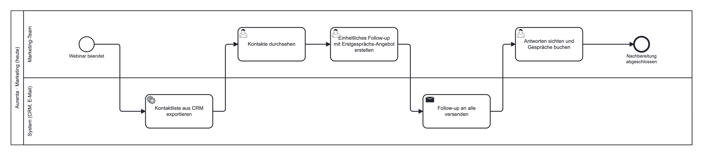
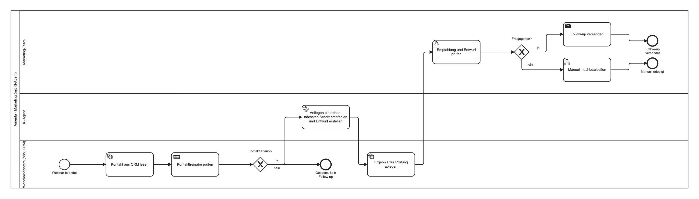
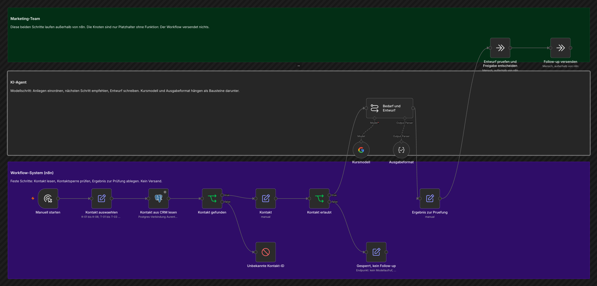

## Der Tag macht aus dem Prototyp einen begründeten Projektzuschnitt

::: {.ws-modules}
::: {.ws-module}
**1 Briefing**Zoi um 10 Uhr: Angebot, Zielgruppe, heutiger Prozess, gewünschter Nutzen
:::
::: {.ws-module}
**2 Ein Lauf vom Montag**K-02: Erwartung, Ergebnis, Ursache
:::
::: {.ws-module}
**3 Ablaufskizze**Swimlane-Diagramm: wer macht was, Regel oder Modell oder Mensch
:::
::: {.ws-module}
**4 Antigravity: Workflow**Ein Agent baut den Workflow aus der Skizze, das Team prüft und importiert
:::
::: {.ws-module}
**5 GitHub**Projektdateien, Repository und Versionsgeschichte
:::
::: {.ws-module}
**6 Student Developer Pack**Persönliches Konto, Studierendenstatus und Angebote einrichten
:::
:::

::: {.notes}
Dienstag: Zoi-Briefing, Ablaufskizze, Antigravity und GitHub. Die Datenauswertung und der Input zu Workflows und Agenten folgen am Mittwoch. Annahmen über Zoi werden von Aussagen aus dem Briefing getrennt, das zieht sich durch den ganzen Tag.
:::

## Drei Fragen pro Team und drei Rollen im Briefing

::: {.ws-compare}
::: {.ws-compare__side .is-left}
[Drei Fragen vorbereiten]{.ws-h}

- eine zu Problem und Ziel
- eine zu Daten und Prozess
- eine zur späteren Nutzbarkeit
:::
::: {.ws-compare__side .is-right}
[Drei Rollen während des Briefings]{.ws-h}

- belegte Aussagen notieren, mit Zeitpunkt
- Annahmen und offene Punkte erkennen
- Fragen stellen
:::
:::

::: {.ws-note}
Vorstellung durch Zoi, danach Fragen. Die Rollen wechseln beim anschließenden Bearbeiten.
:::

::: {.notes}
Die gestern gesammelten Fragen als Ausgangspunkt. Jedes Team markiert die eine Frage, die es selbst stellt. Eine geplante Veranstaltung ist noch kein Nachweis einer getroffenen Vereinbarung: Was Zoi vorhat, ist nicht dasselbe wie das, was Zoi tut.
:::

## Wenn das Ergebnis nicht passt: Woran lag es?

::: {.ws-cards}
::: {.ws-card .fragment}
[Ursache 1]{.ws-card__tag}

[Daten]{.ws-h}

Das Modell hat falsche oder unvollständige Angaben bekommen, zum Beispiel ein leeres Anliegen oder die falsche Kontakt-ID.
:::
::: {.ws-card .fragment}
[Ursache 2]{.ws-card__tag}

[Anweisung]{.ws-h}

Die Angaben stimmen, aber im Prompt fehlt eine Regel oder sie ist unklar. Beispiel: Der Kontakt will nur Material, der Prompt erlaubt trotzdem eine Gesprächseinladung.
:::
::: {.ws-card .fragment}
[Ursache 3]{.ws-card__tag}

[Modell]{.ws-h}

Angaben und Prompt stimmen, die Antwort ist trotzdem falsch. Erst dann lohnt ein anderes Modell oder ein zusätzlicher Prüfschritt.
:::
:::

::: {.ws-note}
Vorgehen: Erst sagen, welche Entscheidung wir für K-02 erwarten. Dann den Lauf starten und vergleichen. Zum Schluss eine konkrete Änderung festhalten.
:::

::: {.notes}
Den Lösungsworkflow mit K-02 an die Wand: Welche Eingabe führte zu welcher Empfehlung? Die drei Ursachen sauber trennen, weil sie drei verschiedene Korrekturen brauchen.
:::

# Ablaufskizze {background-color="#0b0d13"}



## Die Ablaufskizze ist ein Swimlane-Diagramm: eine Bahn je Rolle



::: {.notes}
Notation ist BPMN 2.0, dieselbe wie in Prozessmanagement-Werkzeugen. Für die Übung reichen die drei Bahnen und die sechs Symbole. Symbole anklicken. Werkzeuge: draw.io mit BPMN-Formen oder demo.bpmn.io, beide kostenlos. Ein Foto einer Whiteboard-Skizze ist als erste Fassung zulässig, wenn Bahnen und Entscheidungen erkennbar sind.
:::

## Aurenta heute: alle Kontakte bekommen dieselbe Einladung

{fig-alt="Swimlane-Diagramm des Ist-Prozesses der Webinar-Nachbereitung bei Aurenta."}

::: {.ws-note}
Selbst öffnen: [Datei herunterladen](../material/prozess/aurenta-webinar-ist.bpmn){download="aurenta-webinar-ist.bpmn"}, dann [demo.bpmn.io](https://demo.bpmn.io/new){target="_blank"} öffnen und die Datei hineinziehen.
:::

::: {.notes}
Von links nach rechts lesen. Der Ist-Prozess hat keinen Modellschritt und keine Unterscheidung nach Anliegen. Das ist der Engpass aus der Hypothese: Die Einladung kommt für einen Teil der Kontakte zu früh.
:::

## Aurenta mit KI-Agent: Sperre, Einordnung, Entwurf, menschliche Freigabe

{fig-alt="Swimlane-Diagramm des Soll-Prozesses: Kontakt aus CRM lesen, Kontaktfreigabe prüfen, KI-Agent ordnet Anliegen ein und erstellt Entwurf, Marketing-Team prüft und gibt frei, Versand durch Mensch."}

::: {.ws-note}
Selbst öffnen: [Datei herunterladen](../material/prozess/aurenta-webinar-soll.bpmn){download="aurenta-webinar-soll.bpmn"}, dann [demo.bpmn.io](https://demo.bpmn.io/new){target="_blank"} öffnen und die Datei hineinziehen.
:::

::: {.notes}
Die Kontaktsperre liegt als feste Regel im Workflow-System, vor dem Modell. Der KI-Agent ordnet das Anliegen ein und schreibt den Entwurf. Freigabe und Versand bleiben in der Bahn Marketing-Team. Genau das ist der Workflow 02 von gestern, nur als Prozessbild.
:::

## Derselbe Ablauf in n8n: Bahnen als Notizen, Schritte als Knoten

{fig-alt="n8n-Workflow des Soll-Prozesses, angeordnet in drei Bahnen: Marketing-Team als Notiz außerhalb des Workflows, KI-Agent mit der LLM Chain und ihren Bausteinen, Workflow-System mit Kontakt lesen, Kontaktsperre, Ergebnis zur Prüfung."}

::: {.ws-note}
Selbst öffnen: [Datei herunterladen](../material/workflows/aurenta-soll-n8n.json){download="aurenta-soll-n8n.json"}, dann in n8n einen neuen Workflow anlegen, Menü oben rechts, „Import from file“. Im Postgres-Knoten das Credential „Postgres growth_gN“ wählen, im Kursmodell „Gemini (Gruppe N)“.
:::

::: {.notes}
Jeder Kasten der Skizze ist ein Knoten. Die Bahnen sind in n8n Notizen, sie haben keine Funktion, machen aber sichtbar, was Regel, Modell und Mensch ist. Der Mensch hat keinen Knoten: Der Workflow endet bei „Ergebnis zur Prüfung“. Das ist Beispiel 05 aus dem Starterpaket, nur anders angeordnet.
:::

## Jeder Schritt in der Skizze ist eines von dreien: Regel, KI oder Mensch {.center}

::: {.ws-statement}
Feste Regel: läuft immer gleich, braucht keine KI. KI-Schritt: braucht Sprachverständnis oder muss formulieren. Mensch: entscheidet, gibt frei, versendet. Jeder Kasten in der Skizze bekommt eine dieser drei Arten. KI kommt nur dorthin, wo eine Regel nicht reicht.
:::

::: {.ws-note}
Aus der Skizze ergeben sich die drei Testfälle für Mittwoch: ein normaler Fall, ein Fall mit fehlender Information, ein gesperrter Kontakt.
:::

::: {.notes}
Übung 2.2: fachlichen Weg skizzieren, für den gewählten Ausschnitt Eingabe, Verarbeitung, Ausgabe und menschliche Entscheidung ergänzen, Schritt-Typen markieren, Testfälle festlegen. Mehrere Agenten sind kein Qualitätskriterium.
:::

# Antigravity {background-color="#0b0d13"}



## Der Agent baut den Workflow aus der Skizze, das Team prüft {#antigravity}

::: {.ws-cards}
::: {.ws-card .fragment}
[1]{.ws-card__tag}

[Ordner öffnen]{.ws-h}

Startordner entpacken, in Antigravity als Projekt öffnen: Skizze als BPMN, Muster-Workflow, KI-Anweisung, Auftrag.
:::
::: {.ws-card .fragment}
[2]{.ws-card__tag}

[Auftrag geben]{.ws-h}

Den Auftrag aus AUFTRAG.md in den Chat. Kontext, Aufgabe, Format, Prüfung, wie beim Prompt am Montag, nur ist das Ergebnis eine Datei.
:::
::: {.ws-card .fragment .is-key}
[3]{.ws-card__tag}

[Prüfen, bevor importiert wird]{.ws-h}

zuordnung.md lesen: Jeder Knoten ein Schritt der Skizze? Sperre vor dem Modell? Kein Versand? Korrekturen im Chat beauftragen.
:::
::: {.ws-card .fragment}
[4]{.ws-card__tag}

[Importieren und testen]{.ws-h}

n8n, Import from file, Credential wählen. K-01 muss durchlaufen, bei K-05 darf das Modell nicht starten.
:::
:::

::: {.ws-note}
Der Agent erzeugt, der Mensch prüft. Was der Agent nicht aus der Skizze ableiten kann, fragt er oder sagt es am Ende. Beides ist ein Befund, kein Fehler.
:::

::: {.notes}
Gemeinsam vorne mitgehen. Antigravity ist kostenlos, Gemini für Studierende bringt das höhere Kontingent. Wer die Installation nicht schafft, nimmt den Gemini-Chat mit demselben Auftrag und den Dateiinhalten als Text. Wichtig: Der importierte Workflow ist nicht die Lösung, sondern ein Vorschlag, und die Zuordnungstabelle ist der Prüfgegenstand.
:::

